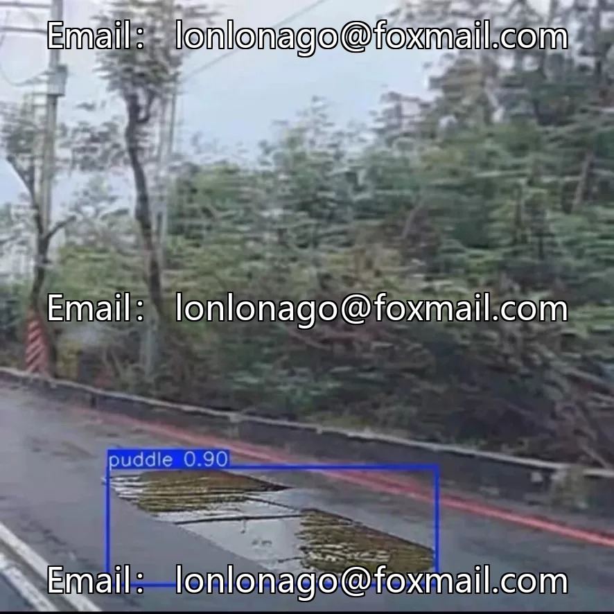
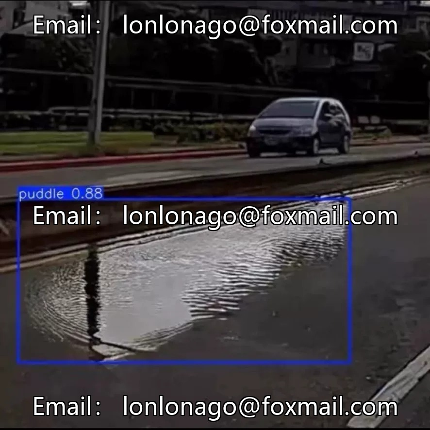
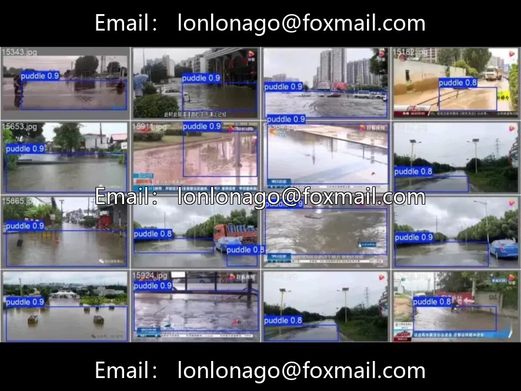
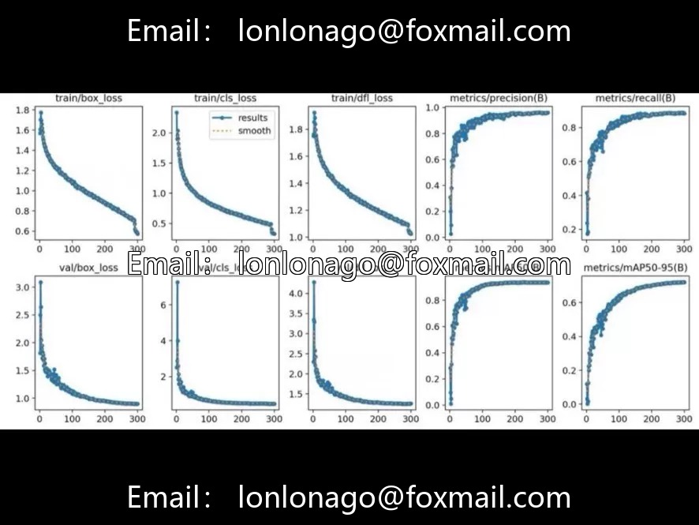
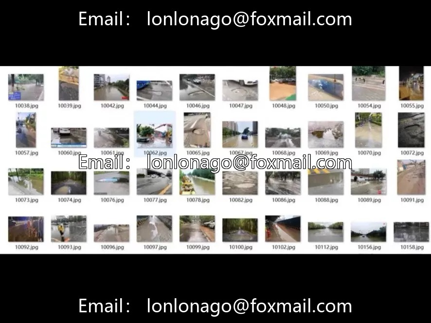

# Smart City Road Waterlogging Detection Dataset, 5200 Real-Scene Labelled Images, YOLO

## Body

Smart City Road Waterlogging Detection Dataset, 5200 real scene labeled images in YOLO format, single-category "Road Waterlogging". Covering various scenarios such as urban main roads, branches, communities, elevated areas, etc., including rainy days with real-time waterlogging, post-rain residuals, and low-lying sections with long-term waterlogging under various weather conditions, fully covered by lighting and weather periods.

Data characteristics: 5200 images with sufficient scale, diverse scenes, and strong generalization capabilities. Optimized annotation for low contrast in road water accumulation and irregular area characteristics. Standard YOLO format, directly applicable to training, validation, and testing of YOLO series models. Complete deliverables include: the optimal weight model file (can be deployed for inference directly), full set of raw images and annotation files, training logs and loss curves, accuracy assessment reports and parameter configuration files.

Application Scenarios: Traffic Monitoring Intelligent Analysis (connecting to real-time monitoring cameras for detecting waterlogging hazards, assisting in traffic warnings and road condition broadcasting), Urban Drainage System Analysis (stating the frequency and locations of waterlogging in a region, providing data support for pipe network renovation and flood control dispatch), Smart City Maintenance (adapting to urban smart inspection and road safety monitoring systems, quickly integrating and implementing).

Core Advantage: The model is optimized for road waterlogging characteristics, with high detection accuracy and low false alarm rate. It features lightweight inference speeds and is suitable for edge device deployment, ready to use out of the box. Suitable for smart city projects, traffic monitoring, municipal drainage, flood prevention early warning systems.

Virtual materials, once sold, are non-refundable.
Interested friends, click "I want" to proceed.

## Images

## Payment

Here is a pay link on Stripe ( https://buy.stripe.com/3cs8yP7sY87d0vu9AB ). Please contact me lonlonago@foxmail.com after funding $89, and I will send you a complete data files , thank you!

